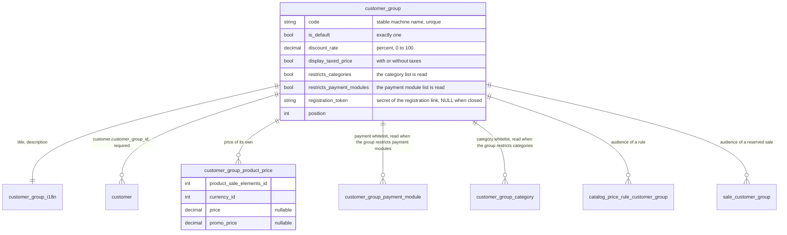

# Customer groups

A customer group is a class of customers a merchant prices, serves and restricts as one: wholesale buyers who pay 15% less
and see prices without taxes, a trade partner who has a price of its own on a range and a payment by transfer nobody else
is offered, a closed catalog only some customers can browse. Every customer belongs to exactly one group; a visitor, a
console command and a guest account are served as members of the default group.

It is written for developers who work on the feature or build a module on top of it. The behavior itself is specified by
the test suites named at the end.

## The model

### The default group

Exactly one group is the default. A new account joins it unless an administrator names another
group or the account registers through the [registration link](#registration-link) of a group, and a visitor, a console command and a guest account are priced and served as its members: a guest row is reusable
by e-mail, which proves no membership anywhere. The default group can neither be deleted nor stop being the default
(`DefaultCustomerGroupProtectedException`); flagging another group releases the previous one. The update creates the
group `default` and puts every existing customer in it.

### The discount

A percentage from 0 to 100, applied to every price the members pay. A rate outside that range is
refused at write (422 on the admin API, `InvalidCustomerDiscountException` on the account events) and counts for nothing
if one is stored. A customer has a discount of their own too (`customer.discount`); it applies after the group's and is
multiplied with it.

### Group prices

A group can have a price and a promotional price of its own for a combination, in a currency
(`customer_group_product_price`, both amounts nullable, untaxed). A price missing in the browsed currency is converted
from the default currency one through `Thelia\Domain\Pricing\CurrencyConverter`; one missing in both leaves the standard
chain in charge. Through the admin API a `POST` with neither amount answers 422, and a `PUT` or a `PATCH` that empties
both deletes the row and answers 204.

### Display with or without taxes

`display_taxed_price` says whether the members are shown prices with taxes (the
default) or without. The core publishes both figures wherever a theme prints one, so a theme chooses and computes
nothing: `taxedPrice` and `taxedPromoPrice` on the front `ProductPrice`, `postageUntaxed` on a delivery option, the
`offered_*` and `line_total_*` keys of the cart lines of `attr()`, and the untaxed totals of `Order`. The display is
frozen on the order with the group and its discount rate (`order.customer_group_id`, `customer_group_discount_rate`,
`customer_group_display_taxed_price`), so an invoice keeps the display the buyer was shown when the group changes later.

### Payment restrictions

A group lists the payment modules it may pay with (`customer_group_payment_module`). The list is read only when the group
is flagged restricted (`customer_group.restricts_payment_modules`). A group that is not restricted can pay with every
module, whatever its list holds. A restricted group pays with the modules its list holds and no other one, an empty list
included: it then pays with no module until an administrator edits the list. The list of a group never opens nor closes
anything to another group: a professional group limited to the transfer pays by transfer only, and the default group,
not restricted, keeps every module. A visitor and a guest are the default group.
`Thelia\Domain\Customer\Service\CustomerGroupPaymentPolicy` is asked, by an explicit call, by the `payment` loop, the
payment options of the API, `CartGuard` at order placement, the composition and the settlement of the payment parts,
and the presentation of an unpaid order to a module. The check is an explicit call and no listener of
`MODULE_PAYMENT_IS_VALID`, so a module that stops that event cannot skip it. The lists are read in one statement per
request, and a shop where no group has a list never asks which group the visitor belongs to.

### Catalog restrictions

A group lists the categories it may browse (`customer_group_category`). The list is read only when the group is flagged
restricted (`customer_group.restricts_categories`). A group that is not restricted sees the whole catalog. A restricted
group opens the categories listed and their sub-trees; their
ancestors stay browsable as a way through (menu, breadcrumb, category page), but the products filed in them are shown
only when an open category holds them too; every other category is closed: out of the lists, the facets, the search,
the sitemap and the API, 404 on its page and on its API item. A product is visible while one of its categories is open,
and a product filed in no category stays visible. A restricted group whose list is empty sees no category at all: nothing
is open, nothing is a way through, and only the products filed in no category stay visible. See
[product-visibility.md](product-visibility.md#categories-closed-to-a-customer-group) for the example and what is
narrowed.

Example. The group `pro` is restricted on both lists and lists the payment module Cheque and the category Sofas (Sofas
sits under Living Room). A member of `pro` sees only Sofas and its sub-categories, with Living Room shown as a way
through (the products filed directly in Living Room are hidden unless an open category holds them too), and pays by
Cheque only. The default group, not restricted, sees the whole catalog and every payment module; the list of `pro`
changes nothing for it. If an administrator deletes Sofas, `pro` stays restricted with an empty category list: its
members see no category until the list is edited.

### The restriction flags

`restricts_categories` and `restricts_payment_modules` say whether the list of a group is read. They are set by
`CustomerGroupLinks::replace()` alone, through the API and the back office: a non-empty list sets the flag, an empty list
clears it, a list left out of the write leaves it. The flags are read-only on `/api/admin/customer_groups`
(`restrictsCategories`, `restrictsPaymentModules`). Deleting the only category or payment module a group lists
empties the list and leaves the flag, so the group stays shut out until an administrator edits the list. In the back
office, the button `Lift the restriction` (`Lever la restriction`) clears the flag of one list explicitly; unticking every
entry of a non-empty list does the same, on purpose. Saving the group for another field changes nothing. The update
script derives the flags from the existing lists once, when it adds the columns.

### Deletion

Deleting a group moves its customers to the default group in the same transaction; the group id of the
orders already placed goes to NULL, and the discount rate and the display frozen on them stay. Its lists of categories
and payment modules go with it: they were its own, so the deletion opens nothing to another group and is never refused
for them. Only the default group cannot be deleted.

## Registration link

A group other than the default one can open a secret registration link. The link carries a token
(`customer_group.registration_token`, unique, NULL while the link is closed). An account that registers with the token of an
open link joins the group instead of the default one; without a token it joins the default group. The group is resolved on
the server from the token and is never a field of the registration data.

- API: `POST /api/admin/customer_groups/{id}/registration_link` opens the link and returns the existing token when one is
  open, `POST .../registration_link/regenerate` replaces the token, `DELETE .../registration_link` closes the link. They
  need the right to update customer groups and an administrator not restricted to a sale unit; the default group answers
  409. `registrationToken` is readable on the single item by the administration only and is never written with the group.
- `POST /api/front/customers` takes `registrationToken` (write only). A token that opens no group (unknown, closed,
  regenerated or malformed) answers 422 on `registrationToken` with one message for every case and creates nothing.
- Domain: `CustomerGroupRegistration` (`open()`, `regenerate()`, `close()`, `groupForToken()`); `CustomerFacade::register()`
  and `CustomerRegistrationService::registerCustomer()` take an optional `?string $registrationToken`;
  `CustomerCreateOrUpdateMinimalEvent::joinGroup()` carries the group to the creation.
- Back office: on the page of a group, `Open a registration link` (`Ouvrir un lien d'inscription`) generates the token and
  shows the link `https://<shop>/register/<token>`. `Regenerate` (`Régénérer`) gives a new token and the links already
  handed out answer 404. `Close` deletes the token. The default group has no link: its members register on
  `/customer/register`.
- On the storefront, `/register/<token>` is the standard registration form and the account created joins the group. The
  token is read from the URL only.
- Registration is rate limited, on the API and on both storefront forms: 5 attempts per address and 20 per client and per
  hour, consumed before the address is looked up (`CustomerRegistrationLimiter`). The API answers 429 with `Retry-After`.
  Behind a proxy or a CDN, declare it in `framework.trusted_proxies` (`TRUSTED_PROXIES`): without it every visitor shares
  the address of the proxy, and the limit per client becomes the limit of the whole shop. Whoever exhausts the budget of
  an address blocks it for an hour, the owner included: the limit cannot tell them apart.

No administrator validates the accounts that register through a link: whoever holds the link joins the group, so a link
is shared with the people it is meant for and regenerated when it leaks. Regenerating invalidates every link already
distributed. A group that becomes the default loses its link. A guest account completed by the registration keeps its
group, since nothing proves yet that the person who signs up owns the address.

## Rights

The API and the back office use the resource `admin.customer.group`, which the update creates and gives to no existing
profile. An administrator restricted to a sale unit (see [sale-unit.md](sale-unit.md)) reads the groups, the group prices
and the group of a customer, and gets a 403 on any write of them. The customer reads their own group (code and title) and
no other one, and can never write it through the front API.

## How a price is resolved

`Thelia\Domain\Pricing\CustomerPrice\CustomerPriceContextInterface::resolve()` answers, for a batch of combinations, a
currency and a customer, what the customer pays: one `ResolvedPrice` per combination priced (a combination nothing prices
is absent, never an exception). It needs three statements at most for the batch, each answer remembered for the request.
The order is:

1. The sale unit speaks first, as it always did: the unit's price for the combination, less the discount of the group,
   never a promotion.
2. Otherwise the price of the group, when it has one: it replaces the catalog price and the catalog promo price.
   Without one, the discount of the group applies to the catalog base price only, never to the catalog promo price; the
   customer pays the lower of the discounted base price and the promo price. When the discounted base price wins, the line
   is not a promotion. The discount of the customer (step 4) applies to whatever won.
3. A catalog price rule or a reserved sale competes with what the group pays, and the lower price wins. When the
   group changes nothing for the combination (no price of its own, no discount), the rule replaces the promo price
   whatever it was, as it did before groups existed. The price a promotion is struck against stays the group's.
4. The discount of the customer applies last, to whatever won.

An example: combination 12, catalog price 100.00 untaxed, group discount 15%, customer discount 10%, no price of the group
and no rule: `untaxedPrice = 100 × 0.85 × 0.90 = 76.5`, `source = 'base'`. With a price of 42 for the group the result is
`42 × 0.90 = 37.8` and `source = 'customer_group'`. With a catalog base price of 100, a group discount of 15% and a
customer discount of 10%, a catalog promo price of 80 gives 72.00 (the promo price wins, then the customer discount), and
a promo price of 90 gives 76.50 (the discounted base price, 85, wins, then the customer discount; the line is no longer a
promotion).

Nothing is rounded along the way. The result is rounded to six decimals when a cart line is written, and to the cent when
a price is displayed or an order total is added up.

The product and `product_sale_elements` loops, the front API (`ProductPrice`, products, combinations), the data access of
the themes, the price facet, the quick order and the cart all read this one context, so a product card, its page and the
cart line show the same price. A shop where no group has a price nor a discount, and no customer a discount, runs the
queries it ran before.

### When prices move before the payment

A group, a group price, a rule or a sale can change the price of a line after it
was added to the cart. The payment prices the lines again first, dispatches `TheliaEvents::CART_LINES_REPRICED` (which
computes the discount of the automatic promotions again), quotes the postage again and stops with
`CartPricesChangedException`: the checkout API answers 409 `cart-prices-changed` with the ids of the lines that moved. The
same request posted again goes through on the new total.

### The cart at sign-in

When a customer signs in with the cart of the session, `CUSTOMER_LOGIN` runs these steps in order, all of them before
`Action\Coupon` reads the cart:

1. The catalog rule runs on the cart: the lines the customer's group or a catalog rule hides are taken out, and a notice
   tells the customer.
2. The remaining lines are priced again for the customer (the price of their group, through `CartLinePricer`).
3. The promotions are computed again, so the discount and the lines a promotion offers follow the new prices, and the
   postage is quoted again.

A cart found again by its cookie goes through the same purge. When it loses lines, `TheliaEvents::CART_LINES_REMOVED` is
dispatched once the session holds the cart: the coupon action computes the discount again and the carrier quotes the postage
again. `CartRestoreEvent::markLinesRemoved()` and `haveLinesBeenRemoved()` carry the information from the restore listener to
the session. A line the visitor can no longer see can be reduced or removed, never increased, and the payment refuses a cart
that still holds one (`CartLineUnavailableException`). See [product-visibility.md](product-visibility.md#the-cart).

## Extension points for a module

### Read what a customer pays

Inject `CustomerPriceContextInterface`. `resolve($productSaleElementsIds, $currency,
$customer)` gives the prices, `customerGroupOf($customer)` the group (the default group for a visitor or a guest) and
`displaysTaxedPrices($customer)` the display. A module that builds a merchant feed or an export prices through it and
reads neither `customer.discount` nor the catalog price on its own.

### Know the group of a customer

`Thelia\Domain\Customer\Service\CustomerGroupResolver::groupIdOf()` and `groupOf()`. A
signed-in customer is read back from the database, once per request. The object the session holds is serialized at
sign-in, so a move made by an administrator would only reach it at the next sign-in.

### React to a move

`TheliaEvents::CUSTOMER_GROUP_CHANGED` carries a `CustomerGroupChangedEvent` (`getCustomer()`,
`getPreviousCustomerGroupId()`, `getCustomerGroupId()`). It is dispatched when an administrator moves a customer, through
the API, the back office or `CustomerGroupAssignment::assign()`; a customer created in a group raises nothing. A module
that moves customers itself (a rule that promotes a buyer after the third order, for instance) calls
`CustomerGroupAssignment::assign($customer, $customerGroupId)`, which returns whether the group changed, and the event
follows. `CustomerCreateOrUpdateEvent` takes an optional last `customerGroupId` to create an account in a group; a group
the shop does not have is refused with `UnknownCustomerGroupException` before anything is written.

### Write the links of a group

`Thelia\Domain\Customer\Service\CustomerGroupLinks::replace()` is the one writer of the
categories and payment modules of a group, for the API and the back office: a list given is the list the group ends up
with and sets the flag of the group, a list left out (null) stays as it is, an empty one clears the list and the flag, all
in one transaction. Nothing is refused and no
other writer is waited for, since a list belongs to its group alone.

### Target groups with a coupon

The condition `Thelia\Condition\Implementation\ForSomeCustomerGroups` (service
`thelia.condition.for_some_customer_groups`, field `customer_groups`, operators `in` and `out`) restricts a promotion to
some groups or excludes them. It reads the group through `CustomerGroupResolver`.

### Target groups with a rule or a sale

A catalog price rule and a reserved sale take audience mode 2
(`AUDIENCE_MODE_CUSTOMER_GROUPS`): the groups are listed in `catalog_price_rule_customer_group` and `sale_customer_group`,
set through `setCustomerGroupIds()` on `CatalogPriceRuleCreateEvent` and `SaleCreateEvent` and read on a single rule or
sale of the admin API (`customerGroupIds`). `Thelia\Domain\Pricing\Rule\Audience\CustomerGroupsAudienceResolver` and
`Thelia\Domain\Sale\SaleAudienceChecker` decide who is entitled. A rule or a sale reserved to groups with none left
applies to nobody, and a guest account is never a member of a group for them. See
[catalog-price-rules.md](catalog-price-rules.md) and [reserved-sales.md](reserved-sales.md).

### Narrow the catalog further

A module that hides more than the closed categories declares a
`ProductVisibilityRuleInterface`, see [product-visibility.md](product-visibility.md).

## The data access cache

The cross-request cache of the data access layer is keyed by the visitor where the answer depends on the visitor. The
price paths (`/api/front/products`, `/api/front/product_sale_elements`) carry the group of the one asking, the country and
the state the taxed price is computed for, and the currency. The categories, the products and their images carry the group
while some group has a list of categories. A customer with a discount of their own, or reachable by a rule or a sale
reserved to named customers or groups, is not served from the cache.

Writing a group, its prices, its categories or its payment modules flushes the pool. Every flush happens at the end of the
request, of the command or of the Messenger message, once the write is committed. The shared cache (proxy) keeps the pages
of anonymous visitors, who all belong to the default group, whatever the groups price.

## Known limits

- Sorts and filters on the price. `untaxed_price_order` on the front API sorts on the untaxed price the visitor pays (group price, promotion, rules, reserved sales, sale unit, group and customer discounts), in the currency browsed, and paginates on the whole narrowed collection. It sorts in SQL on the public price (promotion and public rule included) while nothing prices the catalog differently for the visitor's own group or for them, and in PHP through `VisitorPriceReader` otherwise, up to `THELIA_API_PRODUCT_PRICE_SORT_MAX_PRODUCTS` products (5000 by default): past that, the collection ranks on the public price. The sort is on untaxed prices: with mixed tax rates, the order of the taxed prices of the cards can differ. The price facet (`tfilters[price]`) draws and narrows on the same prices. The price orders and `min_price` / `max_price` of the `product` loop, and the raw `RangeFilter` on `productSaleElements.productPrices.price`, stay on the public catalog price.
- A coupon code typed in a session is invisible to a payment through the API without a session. The checkout API
  prices the cart without the session that holds the code the buyer typed: the discount of the automatic promotions is
  computed (`CouponManager::discountOfCartWithoutSession()`), a code only the session knows is not, nor a promotion that keeps its gifts in the session.
- A restricted group whose list was emptied by a deletion stays shut out. Deleting the last category or the last payment
  module of a restricted group, which takes its link with it, leaves the group restricted with an empty list: it sees no
  category, or pays with no module, until an administrator edits the list or lifts the restriction.
- The sale unit price ignores the price of the group. A unit that prices a combination sets the price; only the
  discount of the group reaches it.

## Test map

- `tests/Api/Admin/CustomerGroupApiTest`, `CustomerGroupProductPriceApiTest`, `CustomerGroupSaleUnitRestrictionApiTest`
  (the admin resources, the 409 on the default group, the 422 refusals, the restricted administrator)
- `tests/Api/Front/CustomerGroupFrontApiTest` (what a customer reads of their group, and cannot write)
- `tests/Api/Front/ProductCustomerPriceApiTest`, `ProductTaxedPriceApiTest`, `ProductPriceOrderApiTest` (the prices and
  the sort)
- `tests/Api/Front/CategoryVisibilityApiTest`, `ProductCategoryVisibilityApiTest`, `CategoryAttachmentsVisibilityApiTest`,
  `ProductAttachmentsVisibilityApiTest`, `tests/Integration/Domain/Catalog/CategoryVisibilityTest`,
  `tests/Integration/Core/Template/CategoryLoopsCustomerGroupTest` (the categories a group may browse)
- `tests/Integration/Domain/Customer/CustomerGroupPaymentPolicyTest`, `tests/Integration/Domain/Module/PaymentModuleCustomerGroupTest`,
  `tests/Integration/Domain/Checkout/CustomerGroupPaymentPlacementTest`, `tests/Integration/Domain/Payment/OrderPaymentCustomerGroupTest`
  (the payment modules a group may pay with)
- `tests/Api/Front/CheckoutPricesChangedApiTest` (the 409 before the payment)
- `tests/Api/Front/CustomerGroupFreeShopQueryCountTest` (a shop with no price nor discount pays no query)
- `tests/Api/Admin/OrderCustomerGroupApiTest`, `tests/Api/Front/AccountOrderCustomerGroupApiTest`,
  `AccountOrderUntaxedAmountsApiTest`, `AccountOrderPublishedAmountsApiTest` (what an order freezes and publishes)
- `tests/Integration/Action/CartCustomerPriceContextTest`, `CustomerDiscountReadFromTheDatabaseTest`
